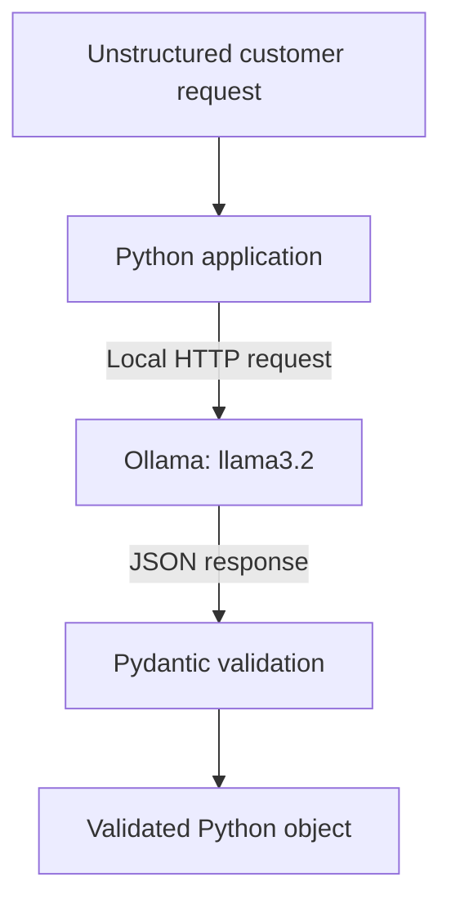

# Local AI Data Pipeline with Ollama & Pydantic Validation

A Python pipeline for extracting and classifying information from unstructured text using Ollama (`llama3.2`) and Pydantic.

Inference runs locally, and model responses are validated against a defined schema before being used by the application.

## Technical Features

- **Local inference:** Processes text using a locally hosted model through Ollama.
- **Structured outputs:** Uses a JSON schema to specify the expected response structure.
- **Pydantic validation:** Checks required fields and data types before creating Python objects.
- **No per-token API fees:** Local inference avoids cloud inference charges. Hardware and electricity costs still apply.
- **Python integration:** Returns validated objects for further processing.

Schema validation checks structure and types. It does not guarantee that the extracted information is correct.

## Architecture Overview



Ollama is accessed through its local endpoint at `localhost:11434`.

## Requirements & Setup

### 1. Install Ollama

Download and install Ollama from [ollama.com](https://ollama.com).

### 2. Download the Model

```bash
ollama pull llama3.2
```

Ensure Ollama is running before executing the Python script.

### 3. Install Python Dependencies

```bash
pip install ollama pydantic
```

Initial installation and model download require internet access. Subsequent inference can run offline once the required dependencies and model are available locally.

## Execution

Run the processor:

```bash
python procesador_local.py
```

## Example Output

The following illustrates the expected output format:

```text
--- RESULTADO PROCESADO EN LOCAL ---
Resumen: Problema de pago
Categoría: Soporte Técnico
Urgencia: Alta
Escalado Humano: True

Tipo de objeto validado: <class '__main__.SolicitudSoporte'>
```

Model-generated values may vary depending on the input and configuration.

## Potential Use Cases

- **Customer support triage:** Extract summaries, classify requests, and identify cases requiring human review.
- **Document processing:** Convert unstructured text into structured records for downstream workflows.
- **Local batch processing:** Process text without sending it to an external inference provider.
- **Offline applications:** Add local language-model capabilities to desktop tools.

## Privacy & Limitations

Local inference can help keep input text on the host machine, provided the surrounding application and infrastructure are configured accordingly.

This project does not, by itself, establish GDPR or HIPAA compliance. Deployment security, access controls, logging, retention policies, and applicable legal requirements must be assessed separately.

Human review remains necessary where incorrect extraction or classification could have significant consequences.
